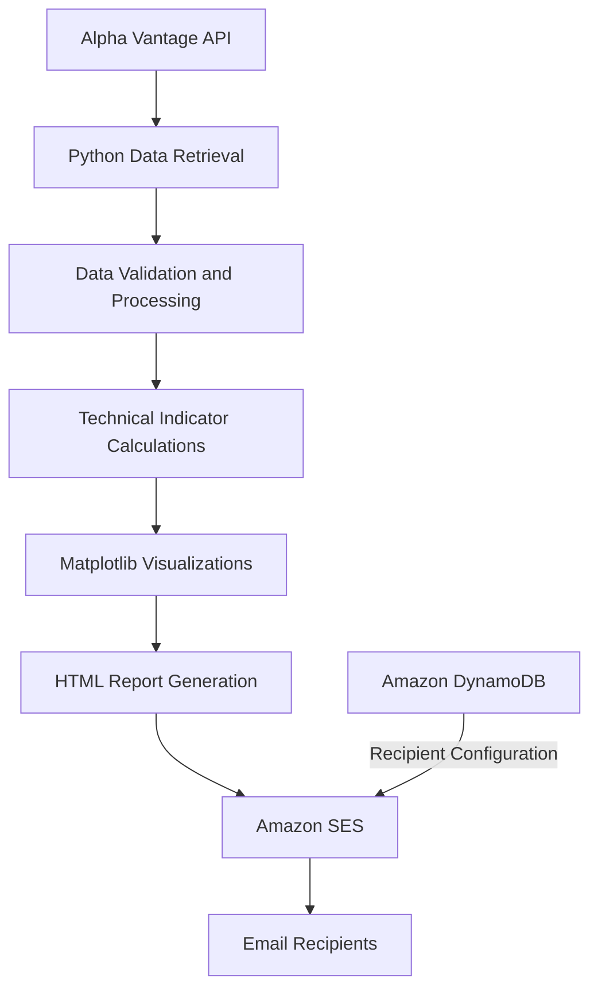

# 📈 Stock Market Analytics & Automated Reporting System

**Python | AWS Lambda | DynamoDB | Amazon SES | Alpha Vantage API | Pandas | Matplotlib | Docker**

A Python-based stock market analytics and reporting system that retrieves historical market data, calculates technical indicators, generates visual reports, and supports automated email delivery through AWS services.

The project combines **financial data analysis, API integration, data visualization, and cloud-based reporting** into a reusable workflow for analyzing stock price movements and distributing market insights.

## Project Overview

The system integrates with the Alpha Vantage API to retrieve daily stock market data, processes historical price and volume information, and generates HTML reports containing financial indicators and Matplotlib visualizations.

It also includes AWS integrations for managing email recipients through DynamoDB and delivering reports using Amazon Simple Email Service (SES).

### Key Capabilities

- **Market Data Integration:** Retrieve daily stock price and volume data through the Alpha Vantage API.
- **Technical Indicator Analysis:** Calculate price-based indicators, including RSI and historical price statistics.
- **Data Processing:** Sort, validate, and process time-series data for consistent analytical calculations.
- **Financial Visualization:** Generate Matplotlib charts to illustrate historical market trends.
- **HTML Report Generation:** Combine financial metrics, visualizations, and ticker descriptions into structured reports.
- **AWS Email Integration:** Retrieve email configuration from DynamoDB and distribute reports through Amazon SES.
- **Cloud-Ready Structure:** Provide a Python `lambda_handler` entry point and a Dockerfile for containerized CLI execution.

## Technology Stack

| Category | Technologies |
|---|---|
| Programming | Python 3.12 |
| Data Processing | Python-based time-series processing |
| Financial Data API | Alpha Vantage |
| Data Visualization | Matplotlib |
| Cloud Services | AWS DynamoDB, Amazon SES |
| Serverless Entry Point | AWS Lambda-compatible Python handler |
| Containerization | Docker |
| Reporting | HTML, email attachments |
| Testing | Python unittest |

## System Architecture



The diagram represents the implemented application workflow, not a verified production deployment.

## Financial Analytics

The reporting workflow supports several forms of market analysis.

| Analytical Component | Description |
|---|---|
| Historical Price Analysis | Evaluates daily stock price movements over available time windows |
| Relative Strength Index (RSI) | Measures price momentum using a simple rolling-average calculation |
| Trading Volume Analysis | Identifies historical minimum and maximum volume values |
| Time-Series Visualization | Generates charts to illustrate market movements |
| Indicator Availability | Marks indicators as unavailable when insufficient historical data exists |

**RSI implementation:** The current calculation uses simple rolling averages rather than Wilder's smoothing method. Rising, falling, and flat price movements are handled explicitly.

These indicators describe historical market behavior and should not be interpreted as guaranteed trading signals.

## Project Setup

### Prerequisites

- Python 3.12
- Alpha Vantage API key
- AWS credentials with appropriate permissions for email delivery
- Configured Amazon SES identities
- DynamoDB email configuration table

### 1. Create a Python Environment

```bash
python3 -m venv .venv
source .venv/bin/activate
```

### 2. Install Dependencies

```bash
pip install -r requirements.txt
```

### 3. Configure Environment Variables

Review `.env.example` and configure the required values.

```bash
export ALPHA_VANTAGE_API_KEY="your-api-key"
export AWS_REGION="us-east-1"
export EMAIL_TABLE="EmailCredentials"
```

Python does not automatically load `.env` files. Export environment variables in your shell or use the included VS Code environment configuration.

Keep credentials and API keys outside version control.

### 4. Configure AWS Services

The application expects a DynamoDB table containing:

- One sender record with `emailID=sender` and an `emailAddress`.
- One or more recipient records using identifiers beginning with `recipient`.

Amazon SES identities and the necessary IAM permissions must be configured separately.

### 5. Run the Application

```bash
python stockMarketAnalysis.py
```

**Important:** Running this command attempts to send an email report through Amazon SES. It is not an offline preview.

## Testing and Validation

Run the automated regression tests using:

```bash
python -m unittest -v test_stock
```

The test suite uses mocked cloud services and does not send real emails.

The project includes corrections and safeguards for:

- Lazy AWS client initialization to avoid cloud calls during import.
- Chronological sorting of historical price data.
- HTTP request timeouts.
- RSI calculations for rising, falling, and flat prices.
- Missing indicator values when historical data is insufficient.
- Accurate trading-volume bounds.
- DynamoDB pagination when retrieving email configurations.
- Email delivery error propagation.
- Prevention of empty report delivery.
- Removal of persistent temporary locks that could suppress later executions.
- HTML escaping for externally retrieved ticker descriptions.

## Docker and AWS Integration

The repository includes a Dockerfile and a Python `lambda_handler` entry point.

The Dockerfile executes the application as a CLI container. It is **not** configured as an AWS Lambda runtime image.

The project does not include complete deployment infrastructure or an automated execution schedule.

Live AWS integration, Docker execution, production deployment, retry behavior, and idempotency require additional environment-specific testing.

Alpha Vantage API usage is subject to subscription and rate limits. The default demo key may not support all symbols or historical data requests.

## Reports and Visualizations

The repository contains historical HTML/PDF report examples and an architecture diagram that illustrate the reporting format and intended system design.

These artifacts are preserved examples, not evidence of a currently deployed reporting service.

## Future Enhancements

Potential improvements include:

- Add configurable reporting schedules using Amazon EventBridge.
- Introduce cloud deployment infrastructure through AWS SAM or Terraform.
- Implement API request caching and retry strategies.
- Add report previews without triggering email delivery.
- Improve delivery reliability with idempotency controls.
- Expand indicator coverage and configurable analysis windows.
- Add monitoring and logging for scheduled reporting workflows.

## Project Documentation

Refer to the repository's supporting documentation for additional details:

- `AUDIT.md` for validation findings and limitations.
- `ATTRIBUTION.md` for project provenance and contributor information.
- `.env.example` for configuration requirements.

## Licensing and Attribution

This project was prepared for maintenance under GitHub account **[ds2204](https://github.com/ds2204)**.

The supplied project did not include a redistribution license. Public redistribution requires confirmation of the applicable permissions.

See `ATTRIBUTION.md` for project provenance and `AUDIT.md` for additional review findings.

---

**Repository maintained under:** [github.com/ds2204](https://github.com/ds2204)

**Focus Areas:** Financial Data Analytics | Python Automation | API Integration | AWS Cloud Services | Data Visualization | Automated Reporting
